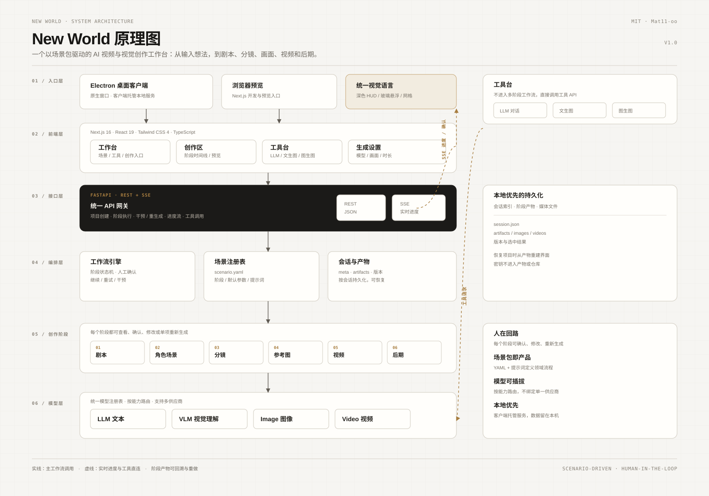
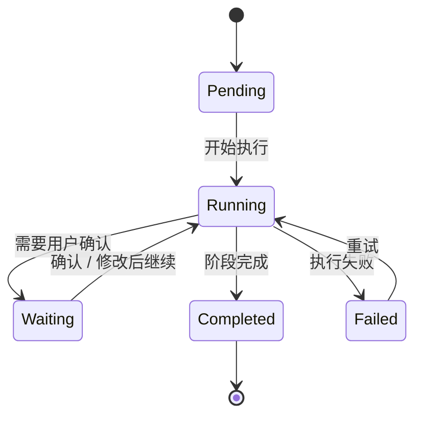
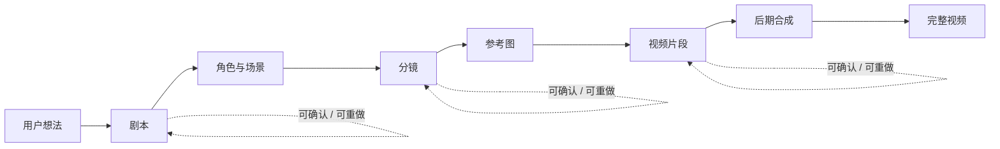
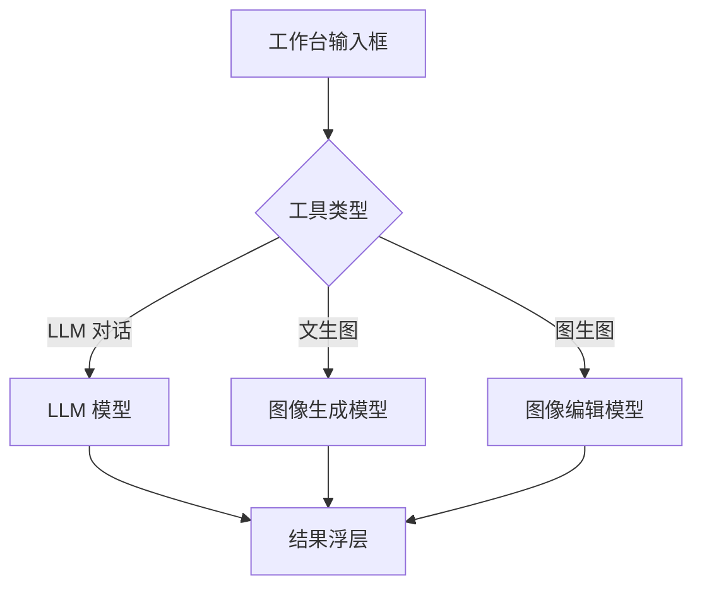
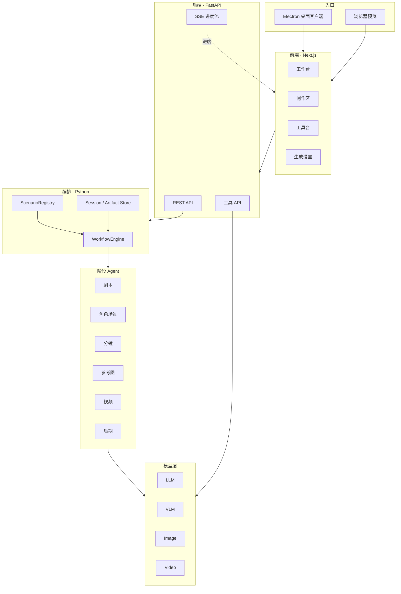

<h1 align="center">New World</h1>

<p align="center">
  <b>AI 视频与视觉创作工作台</b><br/>
  从一句想法出发，完成剧本、角色与场景、分镜、参考图、视频和后期；也可以直接使用对话、文生图和图生图工具。
</p>

<p align="center">
  <b>简体中文</b> · <a href="./README_EN.md">English</a> · <a href="./LICENSE">MIT License</a>
</p>

---

## 目录

- [产品概览](#产品概览)
- [系统原理图](#系统原理图)
- [核心概念](#核心概念)
- [视频生成流程](#视频生成流程)
- [创作工具](#创作工具)
- [技术架构](#技术架构)
- [目录结构](#目录结构)
- [快速开始](#快速开始)
- [模型配置](#模型配置)
- [API 概览](#api-概览)
- [数据与持久化](#数据与持久化)
- [桌面客户端](#桌面客户端)
- [扩展场景](#扩展场景)
- [测试](#测试)
- [常见问题](#常见问题)
- [License](#license)

---

## 产品概览

New World 是一个本地优先的 AI 创作工作台。它把一次内容生产拆成可观察、可确认、可回溯的多个阶段，并通过场景包把同一套流程适配到不同的视频与图像任务。

当前版本包含：

- **视频生成**：一条完整视频从剧本到后期，单段视频时长可选 5 / 10 / 15 秒
- **LLM 对话**：模型选择、联网搜索、结果浮层
- **文生图**：普通图片与商品海报模式
- **图生图**：上传参考图进行风格转换
- **原生桌面客户端**：Electron 窗口，客户端托管本地服务

工作台采用深色 HUD、玻璃悬浮、网格与扫描线视觉语言。工具入口位于工作台顶部，点击后直接在当前页面的输入框中操作，不跳转独立页面。

## 系统原理图



图中从下到上依次为：

1. **模型层**：LLM、VLM、Image、Video 四类能力统一注册与路由
2. **创作阶段**：剧本 → 角色场景 → 分镜 → 参考图 → 视频 → 后期
3. **编排层**：工作流引擎、场景注册表、会话与产物
4. **接口层**：FastAPI REST 与 SSE 进度流
5. **前端层**：工作台、创作区、工具台、生成设置
6. **入口层**：Electron 桌面客户端与浏览器预览

右侧展示了工具直连与运行时数据：工具请求绕过六阶段工作流，直接调用对应模型能力；会话、产物与版本保存在本地运行时目录，不进入仓库。

## 核心概念

### 场景包

场景包是一个目录，位于 `backend/scenarios/<id>/`，由 `scenario.yaml` 声明：

- 场景名称、分类、排序
- 默认风格、比例、分辨率
- 使用哪些阶段，以及阶段顺序
- 首页文案、占位符、示例
- 可选的提示词覆盖
- 可选的定制 Agent

新增一个垂直场景通常只需要复制场景包并修改 YAML 与提示词。

### 阶段

每个阶段都是一次可独立执行、可确认、可重试的 Agent 调用。阶段产出称为 **artifact**，保存在会话中。

| 阶段 | 作用 | 主要输入 | 主要产出 |
| --- | --- | --- | --- |
| `script_generation` | 剧本生成 | 用户想法、风格、素材 | 分集剧本、场景、人物 |
| `character_design` | 角色与场景设定 | 剧本 | 人物设定、场景设定 |
| `storyboard` | 分镜设计 | 剧本、设定 | 分镜、镜头、时长 |
| `reference_generation` | 参考图生成 | 分镜、人物、场景 | 角色图、场景图、首尾帧 |
| `video_generation` | 视频生成 | 分镜、参考图、视频模型 | 视频片段与版本 |
| `post_production` | 后期合成 | 视频片段、字幕、音乐 | 成片 |

### 人工确认

工作流默认支持两种模式：

- **一键生成**：阶段完成后自动继续
- **逐步创作**：每个阶段完成后暂停，等待用户确认、修改或重新生成

阶段状态机：



### SSE 进度流

后端通过 Server-Sent Events 推送阶段进度、日志和资产完成事件。前端据此更新时间线、当前阶段和局部结果，而不是轮询整个项目。

## 视频生成流程



一次视频生成包含：

1. **剧本**：把想法扩写为可拍摄的剧本与分集结构
2. **角色与场景**：提取人物、场景、风格与视觉锚点
3. **分镜**：把剧本拆成带时长的镜头与片段
4. **参考图**：为人物、场景和镜头生成视觉参考
5. **视频**：按分镜和参考图生成视频片段
6. **后期**：拼接、字幕、音乐与最终导出

单段视频时长可在生成设置中选择 **5 / 10 / 15 秒**。当前版本按一条完整视频生成，不再提供自定义集数入口。

## 创作工具

工具不进入多阶段工作流，直接调用工具 API，并在当前工作台页面展示结果。



### LLM 对话

- 选择模型
- 可开启联网搜索
- 输入问题，结果在当前页浮层中展示

### 文生图

- 选择图像模型
- 普通图片模式
- 商品海报模式：自动加入竖版构图、主体突出、标题与卖点排版提示词

### 图生图

- 上传参考图片
- 输入转换要求
- 选择图像编辑模型
- 结果在当前页浮层中展示

## 技术架构



### 技术栈

- **前端**：Next.js 16、React 19、Tailwind CSS 4、TypeScript
- **后端**：FastAPI、Python 3.12、uv
- **桌面端**：Electron
- **工作流**：场景包、阶段 Agent、SSE
- **模型**：LLM / VLM / Image / Video 多供应商注册表
- **存储**：本地会话、artifact 与媒体文件

### 设计原则

- **场景包即产品**：领域流程通过配置组合，而不是复制一套新系统
- **人在回路**：阶段产出可确认、修改、重做
- **模型可插拔**：按能力路由，供应商可替换
- **本地优先**：客户端托管服务，密钥与生成数据不进入仓库
- **单页工具**：工具在当前工作台内完成，减少页面跳转

## 目录结构

```text
backend/
  api/                  FastAPI 路由与请求模型
  core/                 工作流引擎、阶段定义、调度
    agents/             六个内置阶段 Agent
    scenarios/          场景加载、校验与注册
  models/               LLM / VLM / Image / Video 客户端
  registry/             模型注册表
  scenarios/            场景包
    video_generation/   视频生成场景
  templates/            画面模板
  tests/                后端测试
frontend/
  app/                  Next.js App Router
  components/           工作台、工具、阶段与设置
  electron/             Electron 主进程与桌面样式
  lib/                  前端 API、类型与模型注册
  public/ui/            界面静态素材
docs/                   架构、配置、扩展与 API 文档
scripts/                开发与场景脚手架
```

## 快速开始

### 环境要求

- Python 3.12+
- [uv](https://docs.astral.sh/uv/)
- Node.js 18+
- ffmpeg

### 安装依赖

```bash
cd backend
uv sync --extra dev

cd ../frontend
npm install
```

### 配置

```bash
cp backend/config.yaml.example backend/config.yaml
```

在 `backend/config.yaml` 或 `.env` 中填写模型服务密钥。

> 不要提交 `backend/config.yaml`、`.env` 或任何真实密钥。仓库已通过 `.gitignore` 排除这些文件。

### 启动 Web

```bash
./scripts/dev.sh
```

也可分别启动：

```bash
cd backend && uv run python api_server.py
cd frontend && npm run dev
```

前端默认使用 3000 端口，后端默认使用 8000 端口。

### 启动桌面客户端

```bash
cd frontend
npm run desktop
```

该命令会先构建前端，再打开原生客户端窗口。客户端会自动托管后端与渲染进程。

### 打包桌面客户端

```bash
cd frontend
cp desktop.config.example.json desktop.config.json
# 编辑 desktop.config.json，填入本机项目路径
npm run desktop:package
```

`desktop.config.json` 仅用于本机打包，已被 git 忽略。

## 模型配置

模型注册表位于 `backend/registry/`。模型按能力分类：

| 能力 | 典型用途 |
| --- | --- |
| LLM | 剧本、分镜、对话、文案 |
| VLM | 图片理解、角色与场景分析 |
| Image | 文生图、图生图、参考图 |
| Video | 图生视频、首尾帧、参考图生视频 |

配置优先级：

```text
代码默认值 → backend/config.yaml → SFA_* 环境变量
```

模型密钥只应存在于本地配置或环境变量中。

## API 概览

### 场景

| 方法 | 路径 | 说明 |
| --- | --- | --- |
| GET | `/api/scenarios` | 获取可用场景 |
| POST | `/api/scenarios/reload` | 重新加载场景包 |

### 项目与阶段

| 方法 | 路径 | 说明 |
| --- | --- | --- |
| POST | `/api/project/start` | 创建创作项目 |
| POST | `/api/project/{session_id}/execute/{stage}` | 执行指定阶段 |
| POST | `/api/project/{session_id}/intervene` | 人工干预 / 重生成 |
| GET | `/api/project/{session_id}/status` | 获取项目状态 |
| GET | `/api/project/{session_id}/artifact/{stage}` | 获取阶段产物 |

### 工具

| 方法 | 路径 | 说明 |
| --- | --- | --- |
| POST | `/api/sandbox/llm` | LLM 对话 |
| POST | `/api/sandbox/t2i` | 文生图 |
| POST | `/api/sandbox/i2i` | 图生图 |
| GET | `/api/sandbox/history` | 工具历史 |

请求与响应字段见 [docs/api.md](./docs/api.md)。

## 数据与持久化

每个项目有独立的会话目录，保存：

- `meta`：场景、输入、模型、参数
- `artifacts`：各阶段产物
- `status`：阶段状态与错误
- 媒体文件：参考图、视频片段、导出结果
- 版本信息：同一资产的历史版本与当前选中项

项目恢复时，前端根据会话与 artifact 重建阶段时间线，不依赖浏览器本地状态。

## 桌面客户端

- 原生 Electron 窗口，不打开浏览器标签页
- 自定义 HUD 标题栏
- 客户端自动托管 FastAPI 与 Next.js
- 启动后显示开机封面，由用户进入工作台
- 支持 macOS arm64 打包

详细说明见 [frontend/DESKTOP.md](./frontend/DESKTOP.md)。

## 扩展场景

新增场景的最小步骤：

```bash
python3 scripts/new-scenario.py my_scenario --from video_generation --name 我的场景
```

然后修改：

1. `backend/scenarios/my_scenario/scenario.yaml`
2. 可选的 `prompts/` 提示词覆盖
3. 必要时添加自定义 Agent

完整教程见 [docs/tutorial-first-scenario.md](./docs/tutorial-first-scenario.md)。

## 测试

```bash
cd backend
uv run --extra dev pytest

cd ../frontend
npx tsc --noEmit
npm run build
```

后端测试覆盖场景校验、配置合并、工作流状态与可扩展性；前端检查类型与生产构建。

## 常见问题

### 页面提示模型配置未就绪

检查 `backend/config.yaml` 中的模型密钥与模型名称，并确认对应供应商可用。

### 图片或视频生成失败

- 检查模型是否在当前账号下可用
- 检查额度、网络和模型端点
- 文生图与图生图默认使用 720P，以适配常见模型的像素限制
- 失败时会返回明确错误，不再以空结果伪装成功

### VLM 额度不足

角色与场景、参考图阶段依赖 VLM。若供应商返回额度错误，需要充值、关闭免费额度限制，或切换到可用的视觉模型。

### 客户端无法启动

确认 Python、Node.js、uv 与 ffmpeg 已安装，并检查客户端日志中的后端与前端启动信息。

## License

[MIT](./LICENSE)

Copyright (c) 2026 Mat11-oo
