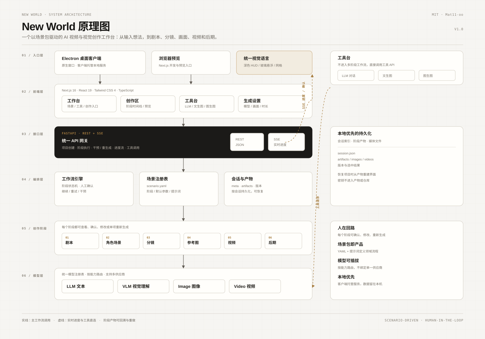
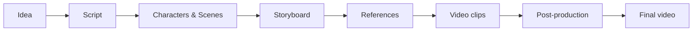

<h1 align="center">New World</h1>

<p align="center">
  <b>AI video and visual creation workspace</b><br/>
  Turn an idea into script, storyboard, visuals, video and post-production — or use the built-in chat, text-to-image and image-to-image tools.
</p>

<p align="center">
  <a href="./README.md">简体中文</a> · <b>English</b> · <a href="./LICENSE">MIT License</a>
</p>

---

## Overview

New World is a local-first AI creation workspace. It breaks content production into observable and reviewable stages, then adapts the same pipeline to different video and image tasks through scenario packages.

Current capabilities:

- **Video generation**: script → characters and scenes → storyboard → references → video → post-production
- **LLM chat** with model selection and web search
- **Text to image**, including a product-poster mode
- **Image to image** style transformation
- **Native Electron client**

The workbench uses a dark HUD, glass surfaces and a grid visual language. Tool entries open inside the current workbench, not on a separate page.

## Architecture





Layers:

1. **Model layer**: LLM, VLM, image and video providers behind a registry
2. **Stages**: script, character/scene design, storyboard, references, video, post-production
3. **Orchestration**: workflow engine, scenario registry, sessions and artifacts
4. **API**: FastAPI REST and SSE progress
5. **Frontend**: workbench, creation area, tools and settings
6. **Entry**: Electron desktop client and browser preview

## Key concepts

- **Scenario package**: `scenario.yaml` declares stages, defaults, UI copy and prompt overrides
- **Artifact**: the output of a stage, persisted with version history
- **Human in the loop**: every stage can be confirmed, edited or regenerated
- **SSE**: progress and asset events streamed to the frontend
- **Single-page tools**: tools run in the current workbench and show results in an overlay

## Quick start

Requirements: Python 3.12+, uv, Node.js 18+, ffmpeg.

```bash
cd backend
uv sync --extra dev

cd ../frontend
npm install

cd ..
./scripts/dev.sh
```

The frontend uses port 3000 and the backend uses port 8000 by default.

### Desktop

```bash
cd frontend
npm run desktop
```

The client builds the frontend and opens a native Electron window.

## Configuration

```bash
cp backend/config.yaml.example backend/config.yaml
```

Add model-provider keys to `backend/config.yaml` or `.env`. Both are git-ignored. Never commit real keys.

Configuration precedence:

```text
defaults → backend/config.yaml → SFA_* environment variables
```

## Project structure

```text
backend/
  api/                  REST and SSE routes
  core/                 workflow engine and stage agents
  models/               provider clients
  registry/             model registry
  scenarios/            scenario packages
  templates/            visual templates
frontend/
  app/                  Next.js App Router
  components/           workbench, tools and stage UI
  electron/             Electron main process
  lib/                  API clients and types
docs/                   architecture, API and extension guides
scripts/                development scripts
```

## Testing

```bash
cd backend && uv run --extra dev pytest
cd frontend && npx tsc --noEmit && npm run build
```

## License

[MIT](./LICENSE)

Copyright (c) 2026 Mat11-oo
